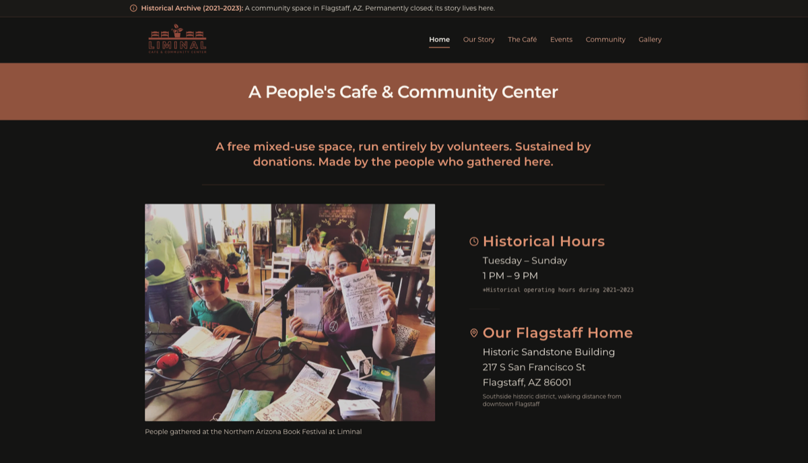
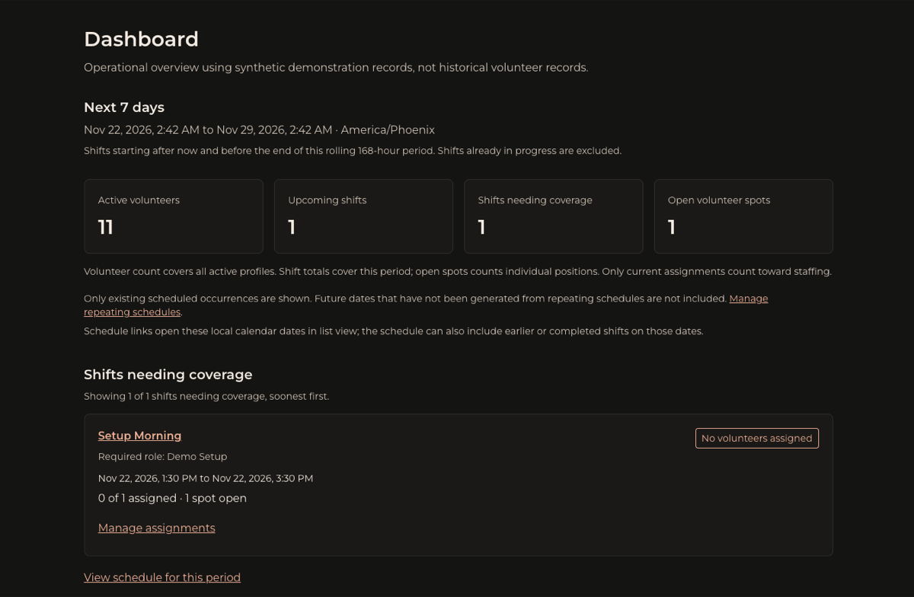
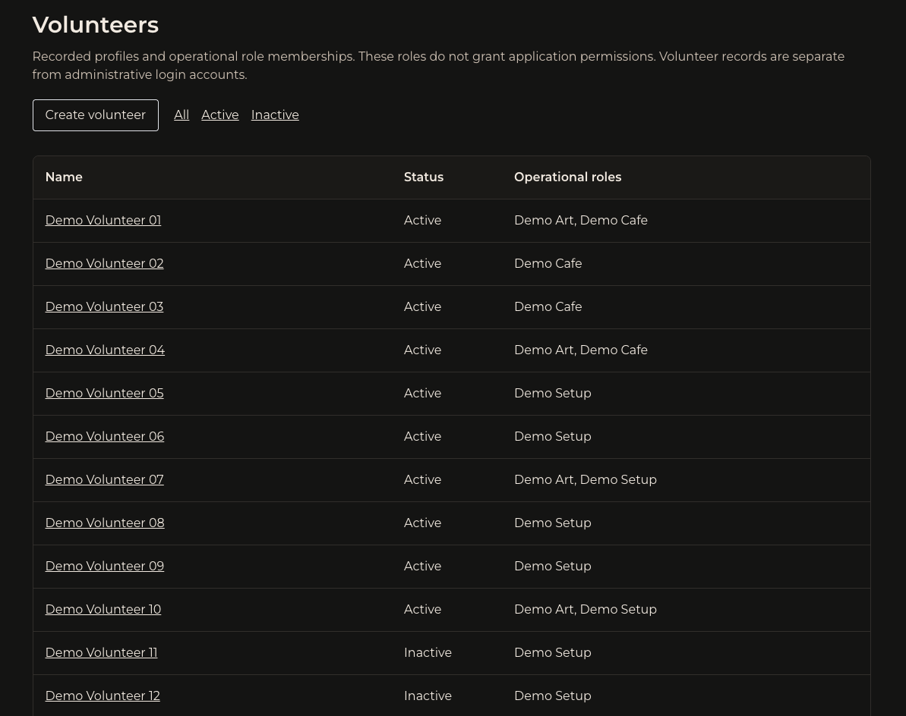
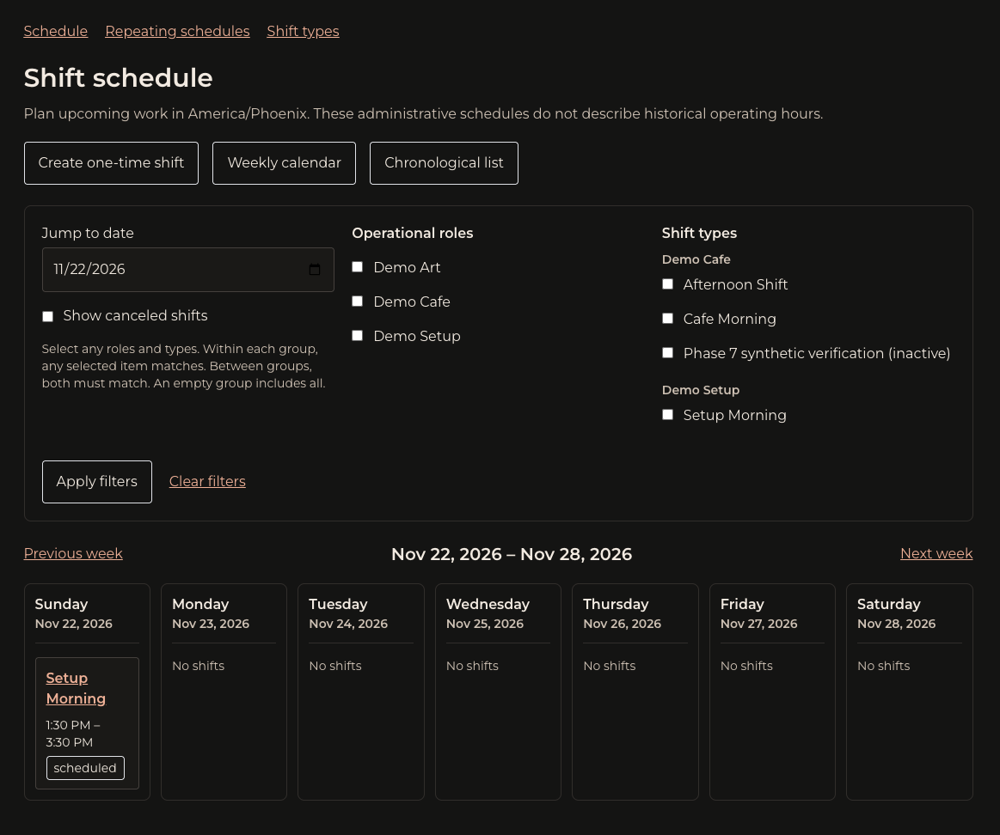
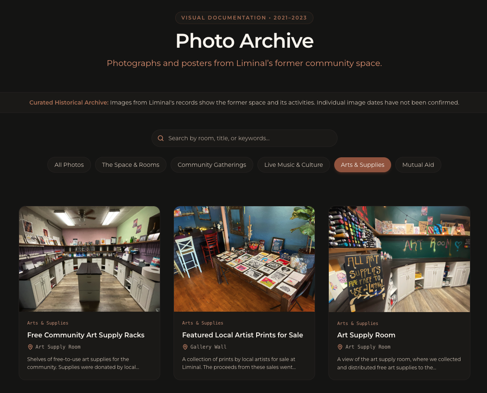

# Liminal Community Center & Cafe

**A public historical archive and a full-stack volunteer management application.**

I co-founded and directed Liminal, a nonprofit community center and pay-what-you-can cafe in Flagstaff, Arizona, that operated from 2021 to 2023. This project preserves its public history and translates volunteer coordination needs into a modern administrative application.

The two parts share one Next.js codebase: a six-page historical website and a protected platform for volunteer profiles, recurring availability, shift scheduling, assignments, and staffing coverage. The administrative software is a modern demonstration inspired by that experience; it was not the system used at the original center. Administrative demonstration records are synthetic.

**Stack:** Next.js 16 · React 19 · TypeScript · Tailwind CSS · PostgreSQL 17 · Prisma 7 · Better Auth · Zod · Vitest



[Administrative platform](#administrative-platform) · [Engineering](#engineering) · [Local development](#local-development) · [Status and limitations](#status-and-limitations)

## Administrative platform

The protected `/admin` application supports the work of coordinating volunteers, from recording availability to filling upcoming shifts. ADMIN and COORDINATOR users can manage volunteers and schedules; VIEWER users have read-only access. Operational roles such as cafe or setup are separate from application permissions.

### Operational dashboard

The dashboard reports active volunteers, upcoming shifts, shifts needing coverage, and open spots over the next seven days. Coverage cards distinguish empty and partially staffed shifts and link directly to assignment controls. Counts reflect recorded occurrences only; reading the dashboard never generates a recurring schedule.



### Volunteer records and availability

Create and edit profiles, filter active/inactive volunteers, maintain operational-role memberships, and record weekly availability with effective start and end dates. Optional food-handler dates are recorded as information, not enforced as assignment qualifications. Profile updates preserve existing assignment relationships.



### Scheduling and recurring shifts

Create one-time shifts, manage a role-organized shift-type catalog, and define weekly repeating patterns. Coordinators explicitly generate or extend occurrences, revise patterns, and shorten or cancel future schedules. A weekly calendar and chronological list support date, role, shift-type, and canceled-shift filters. Scheduling uses `America/Phoenix` local time.



### Assignments and staffing rules

Shift details show staffing, candidate eligibility, availability warnings, and assignment history. The server rechecks each assignment or reactivation against current records:

- **Eligibility:** the volunteer must be active and hold the required operational role; duplicate assignments, overlapping commitments, and full shifts are rejected.
- **Availability:** effective-dated windows must cover the whole shift, including overnight intervals. Outside or unconfirmed availability requires explicit coordinator acknowledgment; it is not an absolute assignment ban.
- **History:** canceling frees a spot without deleting the relationship. Reassigning reactivates the same row after fresh checks. Completed assignments remain read-only.
- **Schedule changes:** future scheduled shifts can change time or be canceled once no active assignments remain. Capacity can change while staffed, but cannot fall below active staffing. Canceled/completed assignment history alone does not block these operations.

Bulk schedule shortening and cancellation are atomic: if any affected shift has active assignments, the entire operation is rejected with links to the blocked shifts. Started, canceled, and completed shifts remain read-only.

## Public historical archive

The public site uses reviewed photographs, posters, and historical descriptions, with a persistent notice that Liminal closed in 2023. Local Montserrat fonts, charcoal and terracotta colors, the original logo, reusable page heroes, and arched photo treatments connect the pages visually. Shared navigation, a resource carousel, and native dialog lightboxes include keyboard and reduced-motion accommodations.

| Route | Content and interaction |
| --- | --- |
| `/` | Introduction, historical location and hours, community resources, photographs, and flyers |
| `/about` | Story, philosophy, and descriptions of the former facilities |
| `/cafe` | Historical cafe description and pay-what-you-can approach |
| `/events` | Category-filtered event records and available archival flyer lightboxes |
| `/community` | Volunteer participation and descriptions of team activities |
| `/gallery` | Photo and poster collection with keyword search, category filters, room labels, and a lightbox |

Legacy routes redirect to their canonical pages; `/facilities` redirects to `/about#facilities`.



These are application screenshots supplied for this repository. Administrative records shown are synthetic, and the dashboard copy excludes the personal account header. [Screenshot provenance](docs/screenshots/README.md) records the source files and preparation.

## Engineering

### Relational model and durable scheduling identity

The [Prisma schema](prisma/schema.prisma) separates authentication accounts from volunteer profiles: a volunteer does not need a login. Twelve models cover auth/session records, profiles, operational roles and memberships, availability, shift definitions, recurring patterns, actual shifts, and assignments.

Database foreign keys, compound uniqueness, and custom SQL constraints complement application validation. Each volunteer/shift pair has one assignment row. Recurring occurrences have an immutable original local date, enforced by a database trigger, distinct from their editable start time. Generation recognizes existing occurrence identities, including canceled ones, so extending a pattern does not silently restore canceled work. See the [database design](docs/database-design.md) and [scheduling guide](docs/phase-5b-scheduling.md).

### Transactions, concurrency, and stale forms

Assignment writes use PostgreSQL `READ COMMITTED` transactions with parameterized row locks in a consistent order: **pattern → shift → volunteer → existing assignment**. Fresh checks after locking protect the last available spot, serialize overlapping assignments for the same volunteer, and coordinate with profile edits. Scheduling mutations share the pattern/shift locks; bulk operations lock affected shifts in stable ID order.

Monotonically advancing timestamp versions reject stale submissions instead of overwriting newer state. Profile, membership, and availability changes commit together. Failed writes roll back; successful writes invalidate the relevant views. The [assignment service](src/server/scheduling/assignments.ts) and [scheduling flexibility guide](docs/phase-5d-scheduling-flexibility.md) show the implementation and its race-condition policies.

The dashboard uses a short **`REPEATABLE READ`, read-only transaction** so counts and coverage lists share one snapshot even if staffing changes during the read. Queries page through shifts with deterministic ordering while retaining only the displayed rows. See the [dashboard design](docs/phase-6-dashboard.md).

### Authentication and validation boundaries

Better Auth manages password credentials and PostgreSQL-backed sessions. Public signup is disabled; local accounts are provisioned through guarded interactive commands. Server services independently check the session and current database role/active status before protected operations, rather than relying on hidden buttons. Origin/CSRF checks remain enabled, and cookies are HTTP-only with Secure enabled for HTTPS.

Zod validates mutation inputs; domain checks run again on the server. Unexpected failures produce sanitized diagnostic references. A response failure may follow a committed write, so error messages instruct the operator to inspect saved state before retrying. See [authentication and provisioning](docs/phase-4-authentication.md) and [diagnostics/readiness](docs/phase-7-readiness.md).

### Automated verification

Unit tests cover validation, time/calendar calculations, availability boundaries, environment safeguards, and diagnostic redaction. PostgreSQL integration tests exercise real queries, Better Auth sessions, constraints, rollback, stale requests, and competing transactions. Concurrency cases include two coordinators competing for the final spot, overlapping assignments, profile edits racing assignment creation, and capacity changes racing reactivation.

The latest [recorded infrastructure validation](docs/phase-8-infrastructure.md) reports **52 unit tests and 140 PostgreSQL integration tests passing**, plus TypeScript, ESLint, and an isolated production build. These are recorded checkpoint results, not a claim of a fresh full-suite run for this README update. Browser verification and hosted checks have separate limits described below.

## Local development

Use **Node 24.22.2** (`.nvmrc` / `.node-version`) and npm; the recorded validation environment used npm 11.19.1. Docker Desktop is required for the local administrative database services. Exact dependency versions are pinned in [package.json](package.json) and the lockfile.

```bash
# With nvm installed:
nvm install
nvm use
npm ci                   # Generates Prisma client; no database connection needed
npm run dev
```

Open [localhost:3000](http://localhost:3000). The public archive works without database or authentication configuration.

### Enable the administrative demonstration

Copy `.env.example` to `.env` **only if `.env` does not already exist**. Set separate random development/test database passwords and matching URL-encoded passwords in the connection URLs. Set `BETTER_AUTH_URL=http://localhost:3000` and an independently generated `BETTER_AUTH_SECRET` of at least 32 random characters. Never commit `.env` or use production credentials locally.

```bash
npm run db:up            # Start isolated development and test PostgreSQL services
npm run db:validate
npm run db:migrate       # Apply committed development migrations; no reset
npm run db:seed          # Add missing synthetic fixtures; preserve existing edits
npm run db:status
npm run auth:provision-admin  # Interactive local bootstrap; no seeded credentials
npm run dev
```

Sign in at `/admin/login`. The guarded `npm run auth:provision-test-user` command can create local VIEWER/COORDINATOR accounts for permission checks. Follow the [backend setup](docs/phase-4-backend.md) and [authentication guide](docs/phase-4-authentication.md) for provisioning prerequisites and command details.

| Database | Local address | Purpose |
| --- | --- | --- |
| Development | `127.0.0.1:5434/liminal_dev` | Local app and synthetic demonstration fixtures |
| Test | `127.0.0.1:5435/liminal_test` | Guarded PostgreSQL integration tests only |

The services have separate credentials and named volumes. Tests validate the target URL and live database identity, never fall back to development, and clean up their own fixtures. `npm run db:stop` stops both services without deleting data.

### Validation commands

```bash
npm test                 # Unit tests
npm run test:db          # Dedicated TEST_DATABASE_URL; applies committed test migrations
npm run typecheck
npm run lint
npm run build
npm run start            # Serve the production build
```

## Status and limitations

The public archive and administrative workflows described above are implemented. **Hosted deployment is not confirmed:** the latest execution record, dated November 16, 2026, reports infrastructure provisioning, migrations, restricted grants, and synthetic initialization complete, with private administrator bootstrap and the first application deployment still pending. See the [execution record](docs/phase-8-stage-d-execution.md); supplied screenshots do not establish deployment status.

The prepared hosting architecture uses Vercel Hobby and Neon Free PostgreSQL, a bounded pooled runtime connection, separate guarded direct operator connections, and manual encrypted backups. Hosted HTTPS/authentication, ingress enforcement, recovery, and end-to-end mutation checks remain required. [Deployment procedures](docs/phase-8-deployment.md) and the [production runbook](docs/production-runbook.md) document these boundaries.

Known limitations:

- An intermittent React Server Component `enqueueModel` / closed-writable-stream issue remains unresolved. Inspect saved state before retrying a failed response; a transaction may already have committed.
- Recurrence is weekly and generated explicitly; availability evaluation supports Phoenix windows, with unsupported-zone information conservatively treated as unconfirmed when Phoenix coverage is insufficient.
- Assignment history preserves relationships and creation/latest-change timestamps, not a full audit trail or the original scheduled interval after a shift is moved. Later volunteer deactivation or role removal does not automatically cancel existing assignments.
- There is no expense ledger, event-management backend, volunteer self-service coverage workflow, completion workflow, or account-management/password-reset UI. Reserved permission names do not imply those features exist.
- Automated service/rendering tests do not establish complete browser accessibility or responsive verification. Local login throttling is process-local; effective hosted ingress protection remains to be verified.

## Repository guide

```text
src/app/(public)/       Six historical routes and public layout
src/app/admin/          Login and protected administrative routes/actions
src/app/api/auth/       Authentication route handler
src/components/        Public presentation and administrative form components
src/data/              Typed public historical content
src/server/            Auth, authorization, database, volunteer and scheduling services
prisma/                Schema, committed migrations and synthetic seed
scripts/               Guarded local provisioning and production operator tools
tests/unit/            Pure logic, validation and configuration tests
tests/integration/     PostgreSQL and authentication workflow tests
public/                Fonts, branding, reviewed archive assets and supplied screenshots
docs/                  Architecture, implementation evidence and operating guides
docs/screenshots/      README screenshot copies
```

Further reading: [architecture](docs/architecture.md), [volunteer management](docs/phase-5a-volunteers.md), [assignments](docs/phase-5c-assignments.md), [design reference](docs/design-reference.md), and [frontend design audit](docs/frontend-design-audit.md). Earlier phase reports describe their original checkpoints; current code and later policy documents supersede them.

## Historical accuracy and privacy

The original center and the modern administrative demonstration are distinct. Use only synthetic administrative records and reviewed public assets; private volunteer applications, contact records, tax materials, and raw archival documents must not be published. Original reference material and local secrets are excluded through repository ignore rules, which do not replace a review before publication.

The [historical-content correction record](docs/phase-3-content-refinement.md) explains removed unsupported chronology, essays, menu/pricing simulation, and shift-standard claims. Precise photo dates and some proposed event occurrences remain unverified. The older [historical research notes](docs/historical-content.md) and [operational workflow notes](docs/operational-workflows.md) provide context, not blanket verification or a feature specification; firsthand corrections and reviewed current content take precedence.
